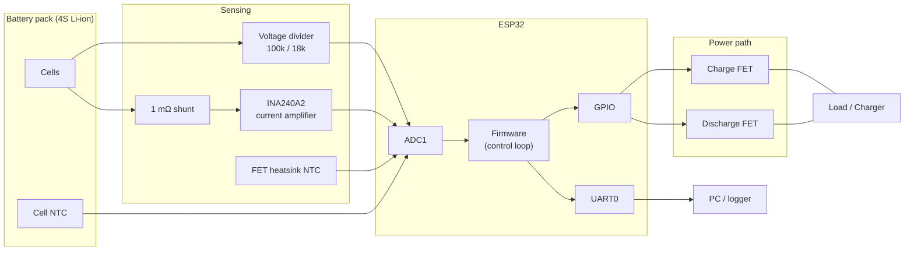
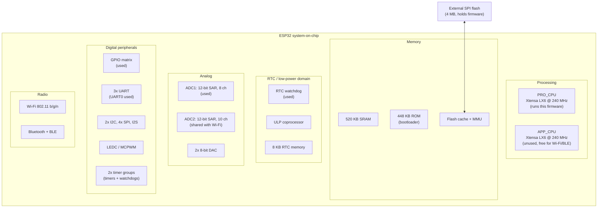
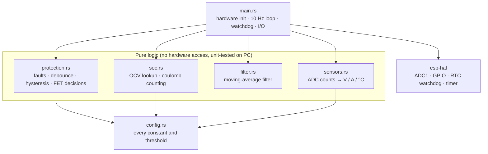
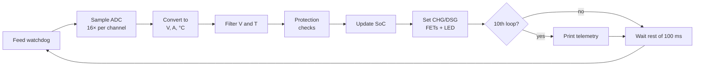
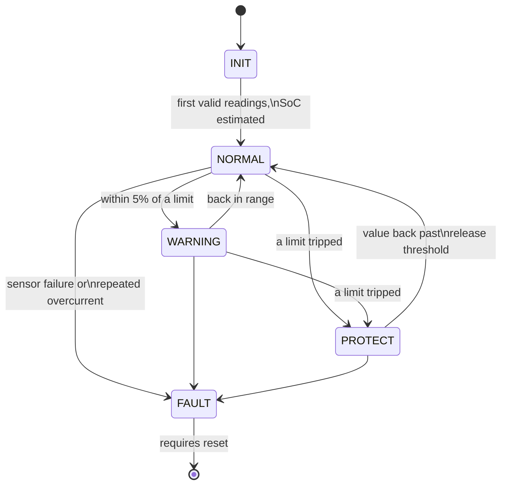
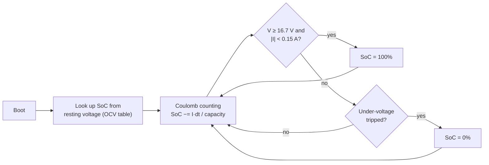

# Battery Management Controller (ESP32, Embedded Rust)

A battery management controller for a 4-cell (4S) Li-ion pack. It measures
pack voltage, current and temperature, and switches the pack's charge and
discharge paths off when anything goes outside safe limits. It also tracks
state of charge and reports status over serial.

The firmware is bare-metal Rust (`no_std`, no operating system) using
[`esp-hal`](https://github.com/esp-rs/esp-hal), Espressif's official Rust
hardware library for the ESP32.

| Pack parameter       | Value                    |
|----------------------|--------------------------|
| Configuration        | 4S1P Li-ion (18650)      |
| Capacity             | 3000 mAh                 |
| Voltage range        | 12.0 V (empty) to 16.8 V (full) |
| Max discharge        | 20 A continuous          |
| Max charge           | 3 A                      |

All limits live in [`src/config.rs`](src/config.rs), so a different pack only
needs changes there.

---

## Contents

1. [System overview](#1-system-overview)
2. [The ESP32 chip](#2-the-esp32-chip)
3. [Hardware architecture](#3-hardware-architecture)
4. [Software architecture](#4-software-architecture)
5. [Protection logic](#5-protection-logic)
6. [State of charge](#6-state-of-charge)
7. [Telemetry](#7-telemetry)
8. [Project layout](#8-project-layout)
9. [Building and flashing](#9-building-and-flashing)
10. [Testing](#10-testing)

---

## 1. System overview



The controller does three things, over and over:

1. **Measure:** read voltage, current and two temperatures through the ADC.
2. **Decide:** compare the readings against safe limits.
3. **Act:** turn the charge and/or discharge MOSFETs on or off, and report.

---

## 2. The ESP32 chip

The ESP32 is a system-on-chip from Espressif. It puts the processor, memory,
analog peripherals and radios on a single die.



### 2.1 Processor

- **Two Xtensa LX6 cores** (`PRO_CPU` and `APP_CPU`), 32-bit, up to 240 MHz.
  This firmware runs on `PRO_CPU` only. `APP_CPU` stays free for Wi-Fi or
  Bluetooth telemetry later.
- **Single-precision FPU** on each core. That is why the firmware can use
  `f32` maths (thermistor logs, current scaling) without a speed problem.
- The Xtensa instruction set is not supported by upstream Rust, which is why
  the build uses Espressif's Rust fork, installed with `espup`.

### 2.2 Memory

- **520 KB internal SRAM** for data and fast code. This firmware uses no heap,
  so all memory use is fixed when it compiles.
- **448 KB mask ROM** holding the first-stage bootloader.
- **External SPI flash** (usually 4 MB) stores the firmware. The CPU runs code
  directly from flash through a cache and MMU.

### 2.3 Analog: the SAR ADCs

- **ADC1** has 8 channels on GPIO32-39. **ADC2** has 10 channels, but it can't
  be used while Wi-Fi is on. This design uses **ADC1 only**, so wireless can
  be added without losing measurements.
- Resolution is 12 bits (0-4095). With **11 dB attenuation** the input range
  is about 0-3.1 V.
- The ESP32 ADC is known to be noisy and not quite linear. The design deals
  with this in three ways: an RC filter on each input, averaging 16 samples
  per reading, and calibrating against a multimeter.

### 2.4 RTC / low-power domain

- The **RTC watchdog (RWDT)** runs from its own clock and keeps working even
  if the main CPU hangs. The firmware feeds it every loop. If the loop stops,
  the chip resets, and the FETs drop to OFF.
- The **ULP coprocessor** can sample the ADC while the main cores sleep. It
  isn't used yet, but it's the path to a low-power storage mode.

### 2.5 Digital peripherals

- The **GPIO matrix** lets almost any peripheral signal go to almost any pin.
  This design uses GPIO25/26 for the FET drivers and GPIO2 for the LED.
- **UART0** goes through the board's USB-to-serial bridge and carries
  telemetry at 115200 baud.
- **I2C / SPI** are free for an upgrade to a dedicated battery monitor chip
  (see 3.2).

### 2.6 Peripherals used by this project

| Peripheral    | Pins / instance     | Purpose                         |
|---------------|---------------------|---------------------------------|
| ADC1 ch6      | GPIO34              | Pack voltage                    |
| ADC1 ch7      | GPIO35              | Current (amplifier output)      |
| ADC1 ch4      | GPIO32              | Cell temperature (NTC)          |
| ADC1 ch5      | GPIO33              | FET heatsink temperature (NTC)  |
| GPIO output   | GPIO25              | Charge FET enable               |
| GPIO output   | GPIO26              | Discharge FET enable            |
| GPIO output   | GPIO2               | Status LED                      |
| RTC watchdog  | RWDT stage 0, 2 s   | Recovery from a hung loop       |
| UART0         | USB bridge          | Telemetry                       |
| Timer         | system time         | Loop timing, coulomb counting   |

---

## 3. Hardware architecture

```
                 PACK+ ──┬───────────────────────────────┬──── LOAD+ / CHARGER+
                         │                               │
                      [100k]                     ┌───────┴────────┐
                         ├──── GPIO34 (V)        │  CHG FET  DSG FET  (back-to-back)
                      [18k]                      └──▲─────────▲───┘
                         │                          │         │
                        GND                      GPIO25    GPIO26
                                                    │         │
     3V3 ─[10k]─┬─ GPIO32 (T cell)       ┌──────────┴─────────┴──────────┐
                └─[NTC 10k]─ GND         │             ESP32             │
                                         │  ADC1: GPIO32-35              │
     3V3 ─[10k]─┬─ GPIO33 (T FET)        │  GPIO2 LED   UART0 telemetry  │
                └─[NTC 10k]─ GND         └──────────────▲────────────────┘
                                                        │ GPIO35 (I)
                                               ┌────────┴────────┐
                                               │ INA240A2  G=50  │ REF = 1.65 V
                                               └───┬─────────┬───┘
                 PACK- ────────────────────────────┴─[1 mΩ]──┴──── LOAD- / CHARGER-
```

### 3.1 Power supply

A wide-input buck converter (for example TPS62160, 16.8 V to 3.3 V) powers the
ESP32 straight from the pack, before the FETs. The controller keeps running
and monitoring even while it has the pack switched off.

### 3.2 Voltage sensing

A **100k / 18k divider** scales the pack voltage down by 6.556×. A full pack at
16.8 V reads as 2.56 V at the pin, which leaves headroom below the 3.1 V ADC
limit.

The divider draws about 142 µA continuously. For long-term storage, a small
MOSFET can switch its low side off.

> **Production upgrade:** a dedicated battery monitor chip (TI BQ76920/BQ76940,
> ADI LTC6811) measures every cell individually and balances them. It connects
> over I2C/SPI. Only the "read voltage" code would change; the protection and
> state-of-charge logic stay the same.

### 3.3 Current sensing

A **1 mΩ shunt** in the negative lead feeds an **INA240A2** amplifier (gain 50).
Its reference pin sits at 1.65 V, so current in both directions is measurable:

```
V_out = 1.65 V + I × 0.001 Ω × 50   =   1.65 V + 50 mV per amp

  +30 A (discharge) → 3.15 V
    0 A             → 1.65 V
  −30 A (charge)    → 0.15 V
```

**Sign convention: positive = discharge, negative = charge.**

At 20 A the shunt dissipates I²R = 0.4 W, so a 2 W four-terminal shunt is used.

> **Hardware short-circuit backup:** a comparator on the amplifier output pulls
> the discharge FET gate low within microseconds, with no software involved.
> The firmware's overcurrent protection is a second layer, not the only one.

### 3.4 Temperature sensing

Each sensor is a **10k NTC thermistor** (B = 3950) in a divider with a 10k
fixed resistor:

```
R_ntc = R_fixed × V / (3.3 V − V)
1/T   = 1/T₀ + ln(R_ntc / R₀) / B          (Beta equation, T in kelvin)
```

- **Cell NTC:** taped to the middle of the cell stack, the hottest spot.
- **FET NTC:** on the MOSFET heatsink.

An open thermistor reads near 3.3 V and a shorted one near 0 V. The firmware
treats both as a **sensor fault** and turns everything off.

### 3.5 Power path

Two independently controlled MOSFET switches:

| FET           | When OFF                        | Driven by |
|---------------|---------------------------------|-----------|
| Charge (CHG)  | Charger can't push current in   | GPIO25    |
| Discharge (DSG)| Load can't draw current out    | GPIO26    |

Because they're separate, a full pack can still discharge, and an empty pack
can still charge. Gate pull-down resistors keep both FETs **OFF** whenever the
ESP32 is in reset, booting or crashed (fail-safe default).

### 3.6 Last-resort protection

A main fuse and a thermal fuse / PTC protect the pack if both the electronics
and the firmware fail.

---

## 4. Software architecture

### 4.1 Layers



Only `main.rs` talks to hardware. Everything else is plain Rust functions
working on numbers. That keeps the safety logic easy to review, and it means
the logic can be tested on a normal PC without an ESP32 connected.

### 4.2 Control loop (every 100 ms)



Voltage and temperature are smoothed with an exponential moving average.
**Current is deliberately not smoothed** for protection, so an overcurrent is
seen on the very next sample. Only the displayed current is smoothed.

### 4.3 System states



| State   | FETs                          | LED          |
|---------|-------------------------------|--------------|
| INIT    | Both off                      | Slow blink   |
| NORMAL  | Both on                       | Solid        |
| WARNING | Both on                       | Slow blink   |
| PROTECT | The affected FET off          | Fast blink   |
| FAULT   | Both off, latched until reset | Fast blink   |

### 4.4 Robustness

- **Watchdog:** a 2-second RTC watchdog resets the chip if the loop ever stalls.
- **Safe startup:** the FETs start OFF and only turn on after a full set of
  valid readings.
- **No heap, no unwraps on runtime data:** a failed ADC read counts as a
  fault. It never crashes the firmware.
- **Panic handling:** `esp-backtrace` prints the panic and halts. The watchdog
  then resets the chip, and the FETs stay off.

---

## 5. Protection logic

| Fault                  | Trip          | Release           | Debounce | Turns off |
|------------------------|---------------|-------------------|----------|-----------|
| Over-voltage           | > 17.00 V     | < 16.60 V         | 300 ms   | CHG       |
| Under-voltage          | < 12.00 V     | > 12.80 V         | 500 ms   | DSG       |
| Over-current discharge | > 25 A        | latched, 5 s retry| 200 ms   | DSG       |
| Over-current charge    | > 4 A         | latched, 5 s retry| 200 ms   | CHG       |
| Cell over-temperature  | > 60 °C       | < 50 °C           | 1 s      | CHG + DSG |
| Too hot to charge      | > 45 °C       | < 40 °C           | 1 s      | CHG       |
| Too cold to charge     | < 0 °C        | > 3 °C            | 1 s      | CHG       |
| FET over-temperature   | > 90 °C       | < 75 °C           | 1 s      | DSG       |
| Sensor fault           | ADC at a rail | never (latched)   | 300 ms   | CHG + DSG |

Three techniques keep the protection both safe and stable:

- **Debounce:** a condition has to hold for several samples in a row before it
  trips. One noisy reading can't cut power.
- **Hysteresis:** the release threshold is set back from the trip threshold, so
  the FETs don't toggle on and off at the limit.
- **Latching with retry:** overcurrent holds the FET off for 5 seconds, then
  tries again. After 3 trips in a row (most likely a real short) it stays off
  until a reset.

The charge and discharge paths are protected separately, so the pack can always
recover. An over-voltage pack can still discharge, and an under-voltage pack can
still charge.

---

## 6. State of charge



- **At boot:** the pack is assumed to be at rest. SoC comes from a Li-ion
  open-circuit-voltage table, with linear interpolation between points.
- **While running:** current is integrated over the measured time step
  (coulomb counting).
- **Re-sync points:** SoC is set to 100% at the end of charge and to 0% at the
  under-voltage cutoff. Coulomb counting slowly drifts, and these points
  correct it.

---

## 7. Telemetry

Once per second, over UART at 115200 baud:

```
BMS st=NORMAL mode=DSG V=15.42 I=+3.21 Tc=27.4 Tf=31.0 SoC=71.3% chg=1 dsg=1 faults=0x0000
```

| Field    | Meaning                                         |
|----------|-------------------------------------------------|
| `st`     | System state (INIT / NORMAL / WARNING / PROTECT / FAULT) |
| `mode`   | CHG, DSG or IDLE (from current direction)       |
| `V`, `I` | Pack voltage (V) and current (A, + = discharge) |
| `Tc`,`Tf`| Cell and FET temperature (°C)                   |
| `SoC`    | State of charge                                 |
| `chg`,`dsg` | FET states (1 = on)                          |
| `faults` | Bit mask of active faults (see `protection.rs`) |

The single-line `key=value` format is easy to parse from a script, a data
logger, or a future Wi-Fi/BLE bridge.

---

## 8. Project layout

```
battery_management/
├── README.md              this file
├── Cargo.toml             dependencies
├── rust-toolchain.toml    selects the Xtensa ("esp") toolchain
├── .cargo/config.toml     target, linker script, flash runner
└── src/
    ├── main.rs            hardware init + control loop
    ├── config.rs          pins, constants, thresholds
    ├── sensors.rs         ADC → engineering units
    ├── filter.rs          moving-average filter
    ├── protection.rs      protection state machine
    └── soc.rs             state-of-charge estimator
```

---

## 9. Building and flashing

You don't need the board to **build**. The firmware cross-compiles on a PC.
The board is only needed to **flash** and run it.

One-time setup (installs Espressif's Rust toolchain for the Xtensa cores):

```bash
cargo install espup espflash --locked
espup install
```

On Linux/macOS, also run `. $HOME/export-esp.sh` in each new shell.

Build:

```bash
cargo build --release
```

Build, flash and open the serial monitor (ESP32 connected over USB):

```bash
cargo run --release
```

### Calibration

Before trusting the readings, compare them with a multimeter and adjust these
values in `src/config.rs`:

| Constant            | What to measure                                  |
|---------------------|--------------------------------------------------|
| `ADC_VREF_MV`       | Known voltage at an ADC pin vs. the reported value |
| `V_DIVIDER_RATIO`   | Pack voltage vs. reported `V`                    |
| `CURRENT_OFFSET_MV` | Amplifier output with zero current flowing       |

---

## 10. Testing

`protection.rs`, `soc.rs`, `sensors.rs` and `filter.rs` don't touch hardware,
and they have unit tests covering:

- trip and release behaviour with hysteresis for every limit
- debounce (one noisy sample doesn't trip)
- overcurrent cooldown, retry and permanent lockout
- sensor-failure lockout
- charge-only and discharge-only blocking
- voltage, current and thermistor conversions
- OCV lookup, coulomb counting and SoC re-sync

They run on a PC by including the modules in a normal host crate and running
`cargo test`.
